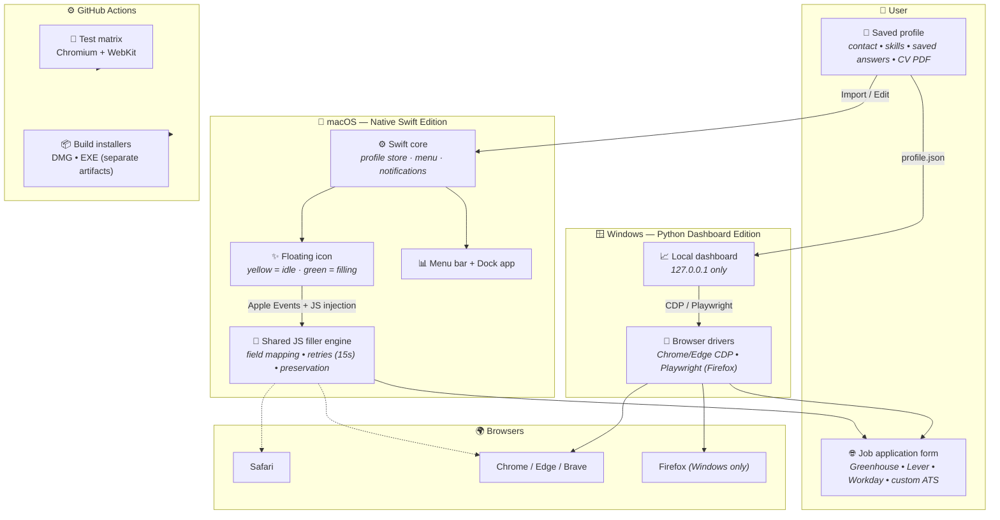
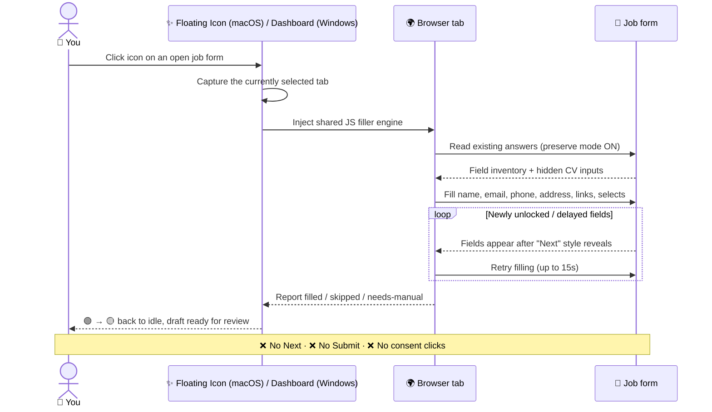

<div align="center">

<p align="center"></p>

# ✨ The Filler

**Your local, privacy-first job-application assistant.**
Fill job forms from your saved profile — *without* ever clicking **Next**, **Submit**, or consent checkboxes.

[](package.json)
[](#-macos-installation)
[](#-windows-installation)
[](#architecture)
[](#-windows-installation)
[](#-tests)
[](#-tests)
[](#-privacy--limitations)

<br>

**[📣 Meet Filler](#-meet-filler--the-one-click-job-application-assistant)** ·
**[🚀 Quick Start](#-quick-start)** ·
**[⬇️ Install macOS](#-macos-installation)** ·
**[⬇️ Install Windows](#-windows-installation)** ·
**[🏛️ Architecture](#-architecture)** ·
**[🧪 Tests](#-tests)** ·
**[📦 Build](#-build-from-source)** ·
**[🔒 Privacy](#-privacy--limitations)**

</div>

---

## 📣 Meet Filler — The One-Click Job Application Assistant

<div align="center">

**We've all been there.** You find a great job opening — only to spend the next **20 minutes** manually re-entering your work history into a slow company web portal.

It's exhausting. It leads to **job-search burnout**, and it lowers the number of applications you can actually send out.

**That's why we built Filler.**

</div>

Floating right on your browser window, **Filler detects application forms instantly.** Place your cursor, click the app, and watch as it:

<table>
<tr>
<td width="50%">

### ⚡ What happens when you click
- 🖱️ **Detects** the application form the moment it appears
- ⚡ **Auto-fills** every personal and professional detail — accurately
- 📄 **Attaches** your CV and cover letter automatically
- ⌨️ **Eliminates** repetitive typing so you can focus on finding the right role

</td>
<td width="50%">

### 🎯 The result
- 📈 **Boost your application output** — more shots on goal, less fatigue
- ⏱️ **Reclaim 20 minutes** per application
- 🧠 **Stay sharp** for the parts that matter — tailoring and interviews
- 🚀 **Land your dream job faster**

</td>
</tr>
</table>

<div align="center">

> ### 🛑 Stop letting tedious forms slow down your career.
> **Boost your application output and land your dream job faster with Filler.**

[⬇️ Install now](#-quick-start) · [🏛️ See how it works](#-architecture)

</div>

---

## 🌟 Why The Filler?

<table>
<tr>
<td width="50%">

### 🎯 What it does
- ✅ Fills **contact fields**, addresses, links and supported selects
- ✅ Finds **hidden CV inputs** by their surrounding section
- ✅ Retries **newly unlocked fields for up to 15 seconds**
- ✅ Generates **local cover-letter / motivation drafts** from your CV summary
- ✅ Attaches your **resume PDF** in one click
- ✅ **Preserves** every answer you already typed

</td>
<td width="50%">

### 🛡️ What it NEVER does
- ❌ Never clicks **Next**
- ❌ Never clicks **Submit**
- ❌ Never clicks **consent checkboxes**
- ❌ Never sends your data to any server — **there is no backend**
- ❌ Never invents company facts (drafts are templates, not LLM output)
- ❌ Never stores a real candidate CV in public builds

</td>
</tr>
</table>

> **You stay in control.** The Filler prepares the form — *you* review every draft, upload and validation message, and *you* press Submit yourself.

---

## ⚖️ Editions at a glance

| | 🍎 macOS Edition | 🪟 Windows Edition |
|---|---|---|
| **Interface** | Native Swift floating icon, menu bar & Dock | Python browser dashboard |
| **Installer** | `.dmg` | Setup `.exe` (bundles Python + Playwright) |
| **Existing browser** | Safari, Chrome, Edge, Brave via Apple Events | Chrome / Edge via remote-debugging session |
| **Firefox** | ❌ Not supported by native edition | ✅ Separate Playwright-launched browser |
| **Floating overlay** | ✅ Yes | ❌ Dashboard only |
| **Status** | Built & tested on Apple Silicon | Build workflow provided; runtime validation required |

<div align="center">

| | |
|:-:|:-:|
| 🍎 The macOS app attaches to your **ordinary browser windows** — no extra profile, no restart. | 🪟 The Windows edition launches or attaches to a **dedicated debugging session** (`--remote-debugging-port=9222`). |

</div>

---

## 🏛️ Architecture



### 🔁 Data flow of a single fill



**Key design points**

- 🔗 **One shared filler engine** — the JavaScript mapping logic lives in `native/` and is reused by both editions, so behaviour stays identical across platforms.
- 🧩 **Driver abstraction** — macOS talks to browsers through *Apple Events*; Windows through *Chrome DevTools Protocol* or *Playwright*.
- 🔒 **Local-only** — no API keys, no telemetry, no cloud. The Windows dashboard binds exclusively to `127.0.0.1`.
- 🧪 **Test-driven safety** — a synthetic-profile regression suite proves *preservation* and *no submission* on every push.

---

## ⚡ Quick Start

<details>
<summary><b>🍎 macOS</b> — 5 steps, ~3 minutes</summary>

1. Download `The-Filler-1.1.0-macOS-arm64.dmg` (or build it — see below).
2. Open the DMG → drag **The Filler** into **Applications** → launch it.
3. Add your details via **Import profile update…** or **Edit CV profile…**, then **Choose resume PDF…**.
4. Enable *Allow JavaScript from Apple Events* in your browser (see the checklist below).
5. Open a job form and click the floating icon. 🟡 idle → 🟢 filling.

</details>

<details>
<summary><b>🪟 Windows</b> — 4 steps, ~3 minutes</summary>

1. Download `The-Filler-1.1.0-Windows-Setup.exe` (or build it — see below).
2. Run the setup — **no Python installation required** (it's bundled).
3. Launch **The Filler** → a local dashboard opens in your default browser.
4. Launch or connect a browser session, open your job form, then **Preview → Apply**.

</details>

---

## ⬇️ macOS Installation

> **Requirements:** macOS 13 Ventura or later · Apple Silicon or Intel (build targets the build machine's architecture — *not* a universal binary)

### 1 · Install the app

```text
📁 The-Filler-1.1.0-macOS-arm64.dmg
        │
        ├── ①  Double-click the DMG
        ├── ②  Drag  ✨ The Filler  →  📂 Applications
        └── ③  Launch from Applications (or Spotlight: ⌘Space → "The Filler")
```

| | |
|:-:|---|
| 📥 | The app appears in **⌘Tab** and the **Dock** |
| 🔔 | Notifications never intercept your clicks |
| 🖱️ | **Drag** the floating icon to reposition it · **Right-click** it for the menu |

### 2 · Create your profile

| Menu action | Purpose |
|---|---|
| **Import profile update…** | Merge a small JSON of contact details (backup saved first) |
| **Edit CV profile…** | Edit the full profile: summary, skills, saved answers |
| **Choose resume PDF…** | Attach the CV you want uploaded |
| **Save question answer…** | Store exact answers, e.g. *"Where did you hear about us?"* → *"LinkedIn"* |
| **Export profile update…** | Produce a reusable contact-details file |

Supported fields: `first name` · `last name` · `full name` · `email` · `phone` · `LinkedIn` · `website` · `street address` · `address line 2` · `city` · `state` · `postal code` · `country` · `country code` — plus standard selects and recognized **Yes/No** controls.

### 3 · Allow JavaScript from Apple Events

The Filler drives your existing browser through Apple Events, so you must opt in **once per browser**:

<details open>
<summary>🍎 <b>Safari</b></summary>

```text
Safari → Settings → Advanced     →  ☑ Show features for web developers
Safari → Settings → Developer    →  ☑ Allow JavaScript from Apple Events
```

</details>

<details>
<summary>🌐 <b>Chrome / Edge / Brave</b></summary>

```text
View → Developer →  ☑ Allow JavaScript from Apple Events
```

</details>

### 4 · Grant Automation permission

On first fill, macOS asks for **Automation** access to control your browser:

```text
System Settings → Privacy & Security → Automation
        └── ☑ The Filler → [Your Browser]
```

> ⚠️ If you deny this, fills will silently do nothing. Approve it for the browser you actually use.

### 5 · Fill your first form

1. Open any job application page in your normal browser window.
2. Keep **one browser window visible** with the **target tab selected**.
3. Click the floating icon — 🟡 yellow *(idle)* → 🟢 green *(filling)*.
4. Review everything that was filled, complete custom/cross-origin fields manually, then **submit yourself**.

<details>
<summary>🤔 <b>Troubleshooting (macOS)</b></summary>

| Symptom | Fix |
|---|---|
| Icon stays yellow | You denied Automation access → re-enable in System Settings → Privacy → Automation |
| Nothing fills in Safari | "Allow JavaScript from Apple Events" is off (needs *Show features for web developers* first) |
| Only some fields fill | Custom widgets & cross-origin frames need manual entry — this is by design |
| Old data missing after upgrade | Data lives in `~/Library/Application Support/Jobfiller` and **is preserved** across upgrades |
| Gatekeeper warning | Builds are **ad-hoc signed**, not notarized → right-click → Open, or allow in System Settings → Privacy & Security |

</details>

### 🍎 Signing note

Local builds use **ad-hoc signing** (no Apple Developer ID / notarization). Public distribution requires a Developer ID certificate **and** notarization. See [Build from source](#-build-from-source).

---

## ⬇️ Windows Installation

> **Requirements:** Windows 10/11 x64 · nothing else — **Python and Playwright browsers are bundled in the installer.**

### 1 · Install

```powershell
# Double-click, or run from PowerShell:
.\The-Filler-1.1.0-Windows-Setup.exe
```

| | |
|:-:|---|
| 🐍 | **No Python needed** — the Setup EXE bundles Python 3.12 + Playwright browsers |
| 📂 | Profile stored at `%APPDATA%\TheFiller\profile.json` |
| 🔏 | Windows code signing is **not** configured yet (expect SmartScreen prompts) |

### 2 · Launch a browser session

Pick **one** of the two modes inside the dashboard:

**Mode A — Launch a dedicated Chrome session**

Close any existing dedicated session first, then:

```powershell
& "$env:ProgramFiles\Google\Chrome\Application\chrome.exe" `
    --remote-debugging-port=9222 `
    --user-data-dir="$env:LOCALAPPDATA\TheFiller\ChromeProfile"
```

**Mode B — Playwright browser (Firefox or Chromium)**

The dashboard launches an isolated browser for you — no flags required.

### 3 · Connect and fill

```text
① Open the job form in the browser window
② Dashboard → "Connect to open browser"
③ Keep ONE window visible, target TAB selected
④ Review  Preview  mode   ←── do this first
⑤ Enable  Apply  when the preview looks right
```

<details>
<summary>🤔 <b>Troubleshooting (Windows)</b></summary>

| Symptom | Fix |
|---|---|
| "Connect" fails | The debugging session isn't running → relaunch Chrome with `--remote-debugging-port=9222` |
| Port already in use | Another Chrome is on 9222 → close it (the dedicated profile avoids this) |
| CV not attaching | `resume_path` must be an **absolute** path, e.g. `C:\Users\You\CVs\cv.pdf` |
| Browser closes on stop | It doesn't — *connecting does not close your browser on stop* |
| Editing profile | Use the dashboard **profile panel** or edit `%APPDATA%\TheFiller\profile.json` |

</details>

---

## 📋 Profile & Answers

Full reference: **[docs/profile-format.md](docs/profile-format.md)** · Blank template: `config/profile.example.json`

### Import format (compact)

```json
{
  "personal": {
    "first_name": "",
    "last_name": "",
    "full_name": "",
    "email": "",
    "phone": "",
    "linkedin": "",
    "address": "",
    "address_line2": "",
    "city": "",
    "state": "",
    "postal_code": "",
    "country": "",
    "country_code": ""
  },
  "application_source": "LinkedIn"
}
```

### Saved answers

```json
"saved_answers": [
  { "question": "Where did you hear about us?", "answer": "LinkedIn" }
]
```

> ### 📌 Golden rules
> - `address` = street / line 1 · keep postal codes as **strings** · use complete `https://` URLs · `country_code` = two-letter code.
> - Import **merges non-empty values only** and saves a local backup first.
> - **Never** infer work authorization or salary from a CV — enter those yourself.
> - Existing page values are preserved; clear a field manually to force-replace it.
> - Public builds ship a **blank template** — never a real CV, phone, email, address or saved answers.

### Drafts are local templates

Motivation and cover-letter text is built **from your saved CV summary** using local templates — not language-model output. It does not invent company facts. Review every draft before submitting.

---

## 🧪 Tests

```bash
npm ci
npx playwright install chromium webkit
npm test                # Chromium engine
npm run test:webkit     # WebKit engine
python3 -m compileall -q app
```

<details>
<summary>🐧 <b>Linux</b> extra step</summary>

```bash
npx playwright install --with-deps chromium webkit
```

</details>

**What the suite covers** (with synthetic profiles and an in-memory dummy resume):

| # | Coverage |
|---|---|
| 1 | Contact-field filling |
| 2 | File uploads (CV) |
| 3 | Delayed unlocks (the 15-second retry window) |
| 4 | Saved choices / saved answers |
| 5 | Draft generation |
| 6 | Repeated fills (idempotency) |
| 7 | **Preservation of existing answers** |
| 8 | **No submission — ever** |

> 💡 Set `CHROME_PATH` to point the suite at a locally installed Chrome.
> Tests never touch real personal data.

---

## 📦 Build from Source

### 🍎 macOS DMG

**Requirements:** macOS + Xcode Command Line Tools

```bash
# Full installer (DMG)
./scripts/build-macos-dmg.sh

# App bundle only
./native/build.sh
```

<details>
<summary>🔐 Privacy-safe packaging guarantees</summary>

- The DMG build **always uses a blank profile and excludes resumes**.
- A private dev build *may* opt in with `THE_FILLER_PROFILE` and `THE_FILLER_RESUME` — **never distribute that build.**
- Output lands in `releases/macos/` (git-ignored).

</details>

### 🪟 Windows EXE

**Requirements:** Windows x64 · Python 3.12+ · [Inno Setup 6](https://jrsoftware.org/isinfo.php)

```powershell
powershell -ExecutionPolicy Bypass -File scripts/build-windows.ps1
```

> ⚠️ **PyInstaller cannot build a Windows executable on macOS.** Use a Windows machine (or the CI workflow below).

### ⚙️ CI / CD

`.github/workflows/build.yml` runs on GitHub Actions:

```text
Actions → Build installers
        ├── 🍎 artifact:  The-Filler-1.1.0-macOS-arm64.dmg
        └── 🪟 artifact:  The-Filler-1.1.0-Windows-Setup.exe
```

| ⚠️ Important | |
|---|---|
| Installers are kept **outside Git history** | Binaries live in `releases/` (ignored) — never force-add them |
| No auto-publish to GitHub Releases | Each artifact must be **tested on its target OS** before a public release |
| "Build succeeded" ≠ "Runs correctly" | Validate runtime behaviour first |

---

## 📁 Repository Layout

```text
TheFiller/
├── 📱 native/               macOS Swift app · shared JS filler · icons
├── 🖥️  app/                 Windows dashboard · browser drivers
├── ⚙️  config/              Blank public profile template
├── 🔧 scripts/              DMG + Windows packaging · installer definitions
├── 🧪 tests/                Synthetic regression tests & fixtures
├── 📚 docs/                 Profile format documentation
├── 🚀 releases/
│   ├── macos/               Local DMG output   (git-ignored)
│   └── windows/             Local EXE output   (git-ignored)
├── 🔐 local/                Private dev profile/CV (git-ignored)
└── .github/workflows/       Tests + separate platform builds
```

---

## 🔒 Privacy & Limitations

<div align="center">

| 🔒 Privacy | ⚠️ Limitations |
|:--|:--|
| **No hosted backend** — 100% local | Custom controls & cross-origin frames may need **manual entry** |
| Your data goes only to the site **you chose** | The target site's scripts can see the data you submit to it |
| Windows dashboard binds to **`127.0.0.1` only** | Firefox unsupported on the **macOS native** edition |
| `.gitignore` blocks profiles, resumes, secrets, installers | No open-source license **yet** — add one before redistributing |
| Never force-add ignored files | Salary / work authorization require **saved answers** |

</div>

> 🚫 Do not fill a form on a site you do not intend to share your details with — the site receives whatever you submit, exactly as if you typed it yourself.

---

## 🗺️ Roadmap

- [ ] Developer ID signing + **notarization** for macOS public distribution
- [ ] Windows code signing certificate
- [ ] Windows runtime validation pass
- [ ] Universal (arm64 + x86_64) macOS binary
- [ ] Firefox support on the native macOS edition
- [ ] Add an open-source license

---

## 🤝 Contributing

```bash
git clone https://github.com/Manohargov/TheFiller.git
cd TheFiller
npm ci
npx playwright install chromium webkit
npm test            # ← must pass before any PR
```

1. Keep **personal data out of commits** (`.gitignore` already blocks the usual suspects).
2. Add regression coverage for any new field type.
3. Never add code that clicks *Next*, *Submit* or consent checkboxes — this is a hard project invariant.

---

## 📄 License

No license has been granted yet. **Add an appropriate license before public redistribution.**

---

<div align="center">

**✨ The Filler** — *fill faster, submit yourself, keep your data local.*

[⬆️ Back to top](#-the-filler)

</div>
